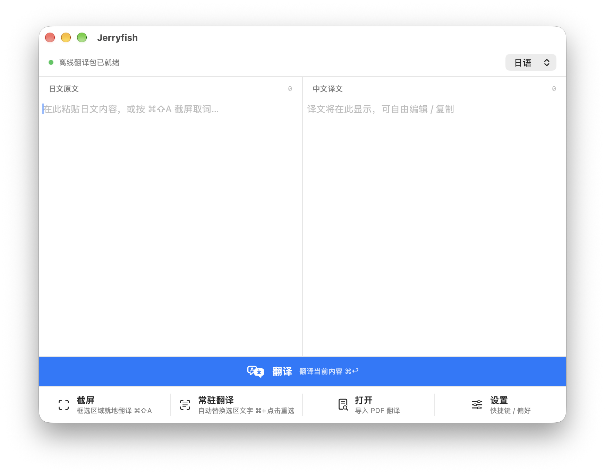
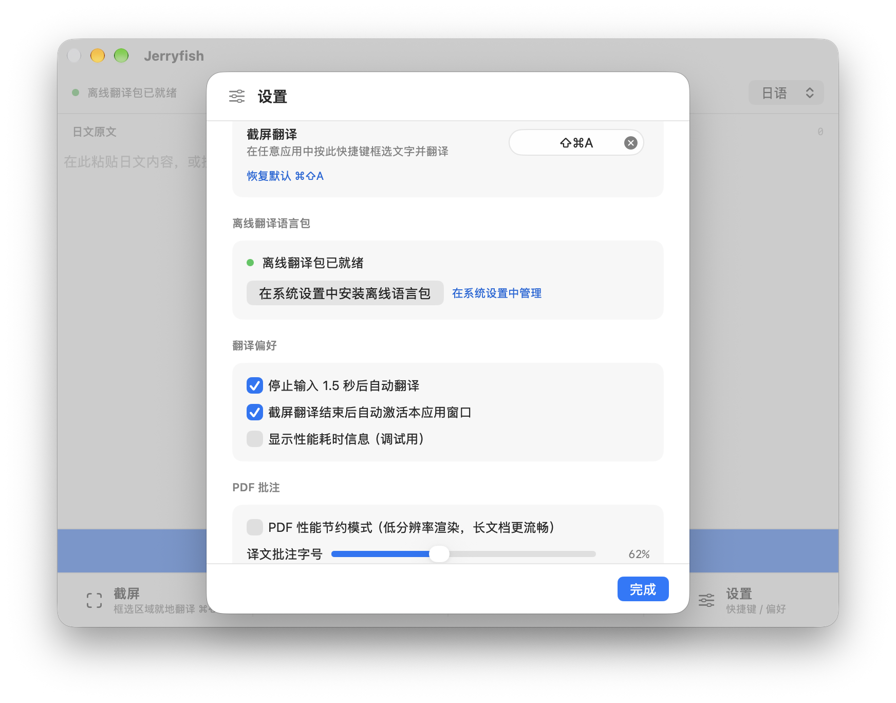

# Jerryfish

面向论文阅读的 macOS 英文、日文到简体中文翻译工具。可以直接粘贴文本、框选屏幕内容，或在 PDF 上生成译文批注。文字识别和翻译使用 Apple 的 Vision 与 Translation 框架；安装好系统离线语言包后，可离线翻译。

**需要 macOS 15 或更新版本。**





## 下载与安装

1. 打开 [GitHub Releases](https://github.com/PungeMao-Mary/Jerryfish/releases/latest)，下载最新版本中的 `Jerryfish-macOS-arm64.dmg`。
2. 打开 DMG，将 `Jerryfish.app` 拖入「应用程序」文件夹。
3. 启动 Jerryfish，并在右上角选择原文语言：英语或日语。
4. 若要使用截屏或常驻翻译，按提示在「系统设置 → 隐私与安全性 → 屏幕录制」中授权 Jerryfish，然后重新启动应用。
5. 首次翻译时如果系统语言包尚未安装，打开「设置 → 离线翻译语言包」，点击下载；也可以到「系统设置 → 通用 → 语言与地区 → 翻译语言」管理。

本项目当前没有 Developer ID 签名和 Apple 公证。macOS 可能在首次打开时显示安全提示；请确认应用来自本项目 Release 后，在 Finder 中按住 Control 键点按应用，选择「打开」，再按系统提示确认。

## 使用方法

### 粘贴文本翻译

1. 在左侧原文栏输入或粘贴英文、日文。
2. 点击蓝色「翻译」按钮，或按 `⌘ Return`。
3. 译文显示在右侧，可继续编辑或复制。原文会保留。

默认开启「停止输入 1.5 秒后自动翻译」，可在设置中关闭。使用右上角语言菜单切换英语或日语。

### 截屏翻译

1. 在任意应用中按 `⌘ ⇧ A`，或点击 Jerryfish 的「截屏」。快捷键可在设置中修改。
2. 拖动框选要识别的区域；点击窗口可选择整个窗口。
3. 识别和翻译结果会覆盖显示在屏幕上。按 `⌘ C` 复制译文，按 `⌘ R` 重新翻译，按 `Enter` 完成并将文字送回主窗口，按 `Esc` 取消。

首次使用需要授予屏幕录制权限。系统授权后，按提示重新启动 Jerryfish。

### 常驻翻译

1. 在主窗口点击「常驻翻译」，然后在屏幕上选择需要持续查看的区域。
2. Jerryfish 会持续识别并翻译该区域；再次点击按钮可停止。
3. 按住 `⌘` 点击「常驻翻译」可重新选择区域。

常驻翻译需要屏幕录制权限。可以在「设置」里关闭自动翻译或调整其他偏好。

### 翻译 PDF

1. 点击「打开」或按 `⌘ O`，选择 PDF 文件。
2. 在 PDF 窗口选择「翻译此页」或「翻译全文」。文字型 PDF 会优先读取文本层；扫描页会使用 OCR。
3. 译文以批注图层显示。可在工具栏中查看和编辑批注，或清除译文批注。

PDF 原文以只读方式打开；批注目前只保存在应用窗口内，不会写回或修改原 PDF 文件。

## 从源码构建

需要安装 Xcode。用 Xcode 打开 `Jerryfish.xcodeproj`，选择 `Jerryfish` scheme 和 `My Mac`，然后运行或构建。首次构建时，Swift Package Manager 会下载 `KeyboardShortcuts` 依赖，因此构建需要网络连接。

也可以在终端运行：

```bash
xcodebuild -project Jerryfish.xcodeproj \
  -scheme Jerryfish \
  -destination 'platform=macOS' \
  build
```

## 技术与隐私

- 屏幕文字识别使用 Apple Vision；屏幕捕获使用 ScreenCaptureKit。
- 翻译使用 macOS `Translation.framework`。翻译在设备上完成；下载 Apple 离线语言包时需要网络。
- 截屏和常驻翻译需要 macOS 的屏幕录制权限。手动粘贴文本不需要该权限。
- 项目依赖 `KeyboardShortcuts`（Swift Package Manager）。

## 许可

Jerryfish 按 [Apache License 2.0](LICENSE) 发布。第三方依赖遵循各自的许可。
